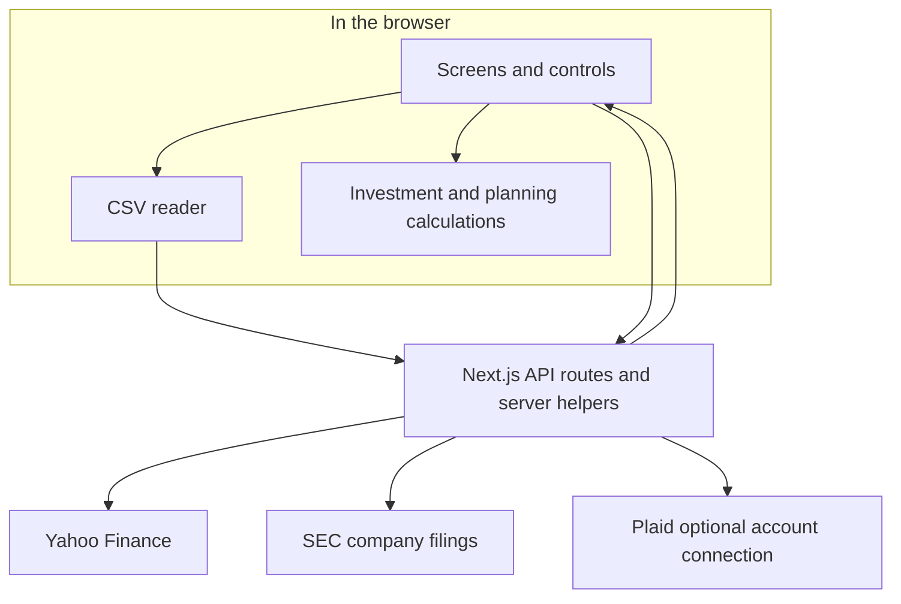

# Portfolio Lab

Portfolio Lab is a web app for understanding a stock portfolio and trying out investment
and spending assumptions. You can import holdings from a CSV file, compare historical
buying schedules, look up a company's reported cash flows, and work through inflation
and withdrawal calculations.

The app displays research and estimates. It does not place trades.

## What you can do

| Workspace or tool    | What it does                                                                                                                                   |
| -------------------- | ---------------------------------------------------------------------------------------------------------------------------------------------- |
| My portfolio         | Reads your holdings, estimates their current value, and shows allocation, concentration, historical risk measures, news, and future scenarios. |
| Stock research       | Compares daily purchases, weekly purchases, a monthly purchase, and a strategy that holds some cash for price drops.                           |
| Financials           | Searches U.S. companies and displays annual cash-flow figures taken from SEC filings.                                                          |
| Inflation calculator | Estimates how an amount of money or a spending budget changes with inflation.                                                                  |
| Withdrawal planner   | Shows how a starting balance might change while you make regular withdrawals.                                                                  |

The inflation and withdrawal tools are part of the portfolio screen. Plaid provides an
optional way to connect an investment account instead of importing a CSV.

## How the app fits together

There are three main parts:

1. **The browser** displays the screens, reads a selected CSV, and runs the local
   investment and planning calculations.
2. **The Next.js server** receives requests from those screens, fetches outside data,
   and prepares portfolio and company-financial results.
3. **The data providers** supply prices, company filings, or connected-account holdings.



`components/` contains the screens and reusable controls. `lib/` contains calculations,
file parsing, shared data definitions, and provider helpers. `app/api/` contains the
server entry points that the browser calls.

There is no application database or user-account system in this version. Reading a
CSV in the browser does not mean all its information stays on the device: the parsed
holdings are sent to the portfolio API for analysis. The original CSV is not saved to
an application database by this code.

### Importing a portfolio

The portfolio screen reads the CSV, and `lib/portfolio-import.ts` turns recognized rows
into a list of holdings. Buy and sell rows are combined by ticker. The screen sends
that list to `/api/portfolio`.

The server retrieves price history and market context, calculates holding statistics
and portfolio summaries, and returns the result. The portfolio screen then draws the
allocation charts, tables, risk summaries, and scenario views.

The current importer accepts common column aliases, but its validation is permissive.
Some unsupported rows are ignored, and some unusual number formats can be interpreted
incorrectly. Check the resulting holdings against the source file. Net invested cash
is not the same as tax-lot cost basis.

### Comparing investment schedules

You choose a ticker, date range, budget, and purchase settings on the stock-research
screen. `/api/market` retrieves daily prices from Yahoo Finance.

Back in the browser, `lib/dca-core.mjs` calculates the different buying schedules. The
screen shows their share counts, average costs, gains, and ending values. The research
helpers also let you download the results as CSV files.

DCA means dollar-cost averaging: dividing an investment budget into scheduled purchases.
The comparison uses the available trading days in the returned price history.

### Looking up a company's cash flows

The financials screen sends a company search to `/api/financials`. The server finds
matching SEC company records. When you select a company, it retrieves that company's
reported facts.

`lib/financials.ts` selects annual periods, keeps each period tied to a filing, and
prepares the cash-flow rows used by the charts and table. Missing figures stay missing.
Free cash flow is calculated only when the necessary operating cash and capital-spending
figures are available.

### Trying inflation and withdrawal assumptions

These tools calculate results in the browser. Inflation estimates use a chosen annual
inflation rate. The withdrawal planner works month by month, taking a withdrawal before
applying that month's assumed growth. It reports balances, shortfalls, and the starting
capital needed for the selected plan.

The assumptions are fixed for a run. The planner does not simulate an unpredictable
sequence of good and bad market years.

## Run it on your computer

Install Node.js 22.13 or newer, with npm. The recorded code checks used Node.js 24.
Then open a terminal in the extracted `StockComparison` folder and run:

```sh
npm ci
npm run dev
```

Open [http://localhost:3000](http://localhost:3000).

`npm ci` installs the versions recorded in the lockfile. `npm run dev` starts the local
development server and updates the page as you edit the project.

You can open the app without Plaid credentials. Historical prices and company filings
need working internet access and available data providers.

### Available commands

| Command             | Purpose                                                                  |
| ------------------- | ------------------------------------------------------------------------ |
| `npm run dev`       | Starts the development server.                                           |
| `npm run lint`      | Checks the source against the project's lint rules.                      |
| `npm run typecheck` | Checks TypeScript data and function types without producing build files. |
| `npm test`          | Runs all five test files with Node's built-in test runner.               |
| `npm run check`     | Runs lint, TypeScript checks, and tests in order.                        |
| `npm run build`     | Creates the production version of the app.                               |
| `npm run start`     | Runs an existing production build. Run the build command first.          |

The current suite contains 41 tests. The tests cover deterministic calculations,
financial normalization, CSV aggregation, and browser-storage subscription behavior.
They do not prove that an outside provider is currently available or that every browser
interaction works.

## A guide to every file

The source archive contains 56 files. The tables below cover all of them. Generated
folders such as `node_modules/` and `.next/` appear after installation or building and
are not part of the source archive.

### Project setup and instructions

| File                 | What it is for                                                                                                              |
| -------------------- | --------------------------------------------------------------------------------------------------------------------------- |
| `README.md`          | This guide: what the app does, how the parts connect, how to run it, and where to find the code.                            |
| `package.json`       | Lists the required packages, the supported Node.js version, and commands such as `dev`, `test`, and `build`.                |
| `package-lock.json`  | Records the exact resolved dependency versions and integrity information so installations can be repeated.                  |
| `tsconfig.json`      | Sets TypeScript's checking rules and file scope. It also makes imports starting with `@/` point to the project root.        |
| `next.config.ts`     | Configures Next.js and adds response headers, including restrictions on framing and browser permissions.                    |
| `eslint.config.mjs`  | Defines the lint checks and excludes generated output from those checks.                                                    |
| `postcss.config.mjs` | Connects the CSS build process to Tailwind so the app's styling can be compiled.                                            |
| `components.json`    | Stores the UI component generator's style, aliases, and folder settings. It is development tooling configuration.           |
| `vercel.json`        | Tells Vercel which framework, install command, and build command to use when hosting the app.                               |
| `.gitignore`         | Lists dependencies, generated output, caches, environment files, and local tool state that should stay out of Git.          |
| `.gitattributes`     | Keeps text-file line endings consistent when files move between operating systems.                                          |
| `AGENTS.md`          | Optional instructions for coding assistants. Here it tells them to read the installed Next.js documentation before editing. |
| `CLAUDE.md`          | A short instruction file for Claude Code. Its `@AGENTS.md` line imports the instructions from `AGENTS.md`.                  |

### App entry points and styling

| File                    | What it is for                                                                                                                                                       |
| ----------------------- | -------------------------------------------------------------------------------------------------------------------------------------------------------------------- |
| `app/layout.tsx`        | Wraps every page with the shared HTML structure, loads the stylesheets, and sets the page title and browser icon.                                                    |
| `app/page.tsx`          | The main page. It switches between portfolio, stock research, and financials; manages research inputs and results; and handles research charts, tables, and exports. |
| `app/globals.css`       | Main app styling: colors, light and dark themes, page layout, charts, tables, and responsive rules.                                                                  |
| `app/design-system.css` | Additional shared styling rules and visual tokens, including chart colors and tooltip appearance. It is loaded after the main stylesheet.                            |

### Server routes

An API route is a URL that runs server code when the browser requests it. For example,
`app/api/market/route.ts` handles requests to `/api/market`.

| File                                       | What it is for                                                                                                                                       |
| ------------------------------------------ | ---------------------------------------------------------------------------------------------------------------------------------------------------- |
| `app/api/market/route.ts`                  | Checks a requested ticker and date range, calls the market-data provider, and returns historical prices or an error.                                 |
| `app/api/portfolio/route.ts`               | Receives holdings, retrieves their market data, and assembles values, allocations, historical returns, risk summaries, news, and future scenarios.   |
| `app/api/financials/route.ts`              | Handles company searches and requests for a selected company's normalized SEC financial data.                                                        |
| `app/api/plaid/create-link-token/route.ts` | Creates the temporary token used to open Plaid's account-connection interface.                                                                       |
| `app/api/plaid/exchange-token/route.ts`    | Exchanges a completed Plaid connection's public token, retrieves investment holdings, combines duplicate tickers, and returns the connection result. |
| `app/api/plaid/holdings/route.ts`          | Uses a saved Plaid access token to retrieve and combine the account's current investment holdings again.                                             |

### Screens and reusable controls

A component is a reusable part of a screen. A whole dashboard can be a component, and
so can a single button.

| File                                     | What it is for                                                                                                                              |
| ---------------------------------------- | ------------------------------------------------------------------------------------------------------------------------------------------- |
| `components/portfolio-dashboard.tsx`     | Portfolio workspace: CSV upload, optional brokerage connection, holding summaries, allocation charts, risk views, news, and planning tools. |
| `components/company-financials.tsx`      | Company search and financials workspace, including cash-flow charts, annual figures, and links to the supporting filings.                   |
| `components/inflation-calculator.tsx`    | The inflation form and result display. It converts the chosen inputs into future-spending or purchasing-power estimates.                    |
| `components/withdrawal-planner.tsx`      | The withdrawal form, chart, summaries, and yearly table. It calls the separate withdrawal calculation module.                               |
| `components/research-details.tsx`        | Shared pieces of the stock-research screen: statistic cards, formatted monthly table cells, and chart tooltips.                             |
| `components/financial-chart-tooltip.tsx` | The formatted values shown when you hover over portfolio or financial charts.                                                               |
| `components/ui/button.tsx`               | Shared button styling, sizes, and variants used throughout the app.                                                                         |
| `components/ui/input.tsx`                | Shared styling and behavior for text and number input fields.                                                                               |
| `components/ui/select.tsx`               | Reusable dropdown controls with shared menu and selection behavior.                                                                         |
| `components/ui/sheet.tsx`                | The slide-out panel used to show extra detail without leaving a screen.                                                                     |
| `components/ui/table.tsx`                | Reusable table, header, row, and cell wrappers with consistent styling.                                                                     |

### Calculations, data handling, and shared helpers

These files do the work behind the screens. Separating them from the display code
makes it easier to check a calculation without opening the entire application.

| File                           | What it is for                                                                                                                                             |
| ------------------------------ | ---------------------------------------------------------------------------------------------------------------------------------------------------------- |
| `lib/portfolio-import.ts`      | Reads CSV text, recognizes supported headers, combines buy and sell quantities, and returns the resulting holdings and import metadata.                    |
| `lib/portfolio-types.ts`       | Defines the expected shapes of holdings, analysis responses, scenarios, and import results. These are TypeScript descriptions, not calculations.           |
| `lib/portfolio-analysis.ts`    | Calculates holding volatility, drawdowns, historical returns, and forecast scenarios. It also fetches ticker context and news used by the portfolio route. |
| `lib/portfolio-projections.ts` | Calculates future value from a starting amount, monthly additions, a time period, and an assumed annual return.                                            |
| `lib/brokerage-token-store.ts` | Reads whether a saved brokerage token exists and notifies React when that browser-storage state changes. It does not encrypt or store tokens on a server.  |
| `lib/market-data.ts`           | Defines the shared price-data shape and the Yahoo Finance provider. It fetches, cleans, deduplicates, and sorts historical daily price records.            |
| `lib/sec-data.ts`              | Searches the SEC company list and retrieves Company Facts data, with request timeouts and caching settings.                                                |
| `lib/financials.ts`            | Turns reported SEC facts into consistent annual cash-flow periods while retaining filing dates and accession identifiers.                                  |
| `lib/dca-core.mjs`             | Runs the daily, weekly, monthly, and dip-wait strategy calculations using the available historical prices.                                                 |
| `lib/dca-core.d.mts`           | Gives TypeScript the argument and result definitions for `dca-core.mjs`. It describes the JavaScript module rather than duplicating its calculations.      |
| `lib/withdrawal-plan.mjs`      | Runs the monthly withdrawal simulation and calculates required capital, balances, total withdrawals, shortfalls, and depletion timing.                     |
| `lib/withdrawal-plan.d.mts`    | Gives TypeScript the input and result definitions for the withdrawal module.                                                                               |
| `lib/research-utils.ts`        | Shared date and number formatting, research table types, and the browser CSV-download helper.                                                              |
| `lib/utils.ts`                 | Combines CSS class names and resolves conflicting Tailwind classes for the shared UI controls.                                                             |

### Tests

| File                            | What it checks                                                                                                                         |
| ------------------------------- | -------------------------------------------------------------------------------------------------------------------------------------- |
| `tests/dca.test.mjs`            | Monthly budgets, share counts, daily and weekly buying, dip thresholds, chosen purchase days, holidays, and partial date ranges.       |
| `tests/financials.test.mjs`     | Annual-period selection, consistent restatements, missing figures, genuine zero values, and unusual fiscal-year lengths.               |
| `tests/portfolio-core.test.mjs` | The actual portfolio modules: CSV aggregation, contribution projections, history statistics, forecasts, and saved-token subscriptions. |
| `tests/portfolio.test.mjs`      | Two standalone formula sanity checks for long-horizon growth limits and percentage return. These do not exercise the portfolio API.    |
| `tests/withdrawal.test.mjs`     | Inflation timing, withdrawals, depleted balances, required capital, and rejected input assumptions.                                    |

### Static assets and third-party files

| File                                       | What it is for                                                                      |
| ------------------------------------------ | ----------------------------------------------------------------------------------- |
| `public/favicon.svg`                       | The small icon shown in the browser tab.                                            |
| `vendor/shadcn-tailwind-4.13.0.css`        | A bundled stylesheet used by the UI. The main stylesheet imports it.                |
| `vendor/shadcn-tailwind-4.13.0.LICENSE.md` | The license notice for that bundled third-party stylesheet. Keep it with the asset. |

## Do AGENTS.md and CLAUDE.md need to stay?

They are not required to install, build, or run Portfolio Lab. They are development
instructions for coding assistants.

In this repository, `AGENTS.md` contains a Next.js reminder to read the documentation
bundled with the installed framework version. `CLAUDE.md` contains only `@AGENTS.md`,
which tells Claude Code to read that same file. It is not cloud-hosting configuration.
There is no `cloud.md` in this source archive.

Keeping them is useful when coding assistants work on the project. Removing them does
not remove an app feature. This installed Next.js version can generate these instruction
files during development when it detects a coding agent and the managed rules are missing.

## Optional provider settings

| Environment variable | Used for                                                                        |
| -------------------- | ------------------------------------------------------------------------------- |
| `PLAID_CLIENT_ID`    | Identifies the configured Plaid application.                                    |
| `PLAID_SECRET`       | Authenticates server requests to Plaid. Keep its value out of source control.   |
| `PLAID_ENV`          | Selects the Plaid environment. The routes default to `sandbox`.                 |
| `SEC_USER_AGENT`     | Overrides the identifying header sent to the SEC. The code has a default value. |

Set these through local environment configuration or the hosting platform. Do not put
real values in a shared source archive.

The current Plaid workflow saves its access token in browser storage and sends it back
to the server when refreshing holdings. This needs a different storage and authentication
design before use as a shared public brokerage application. Plaid-derived invested amounts
and dates are approximations from holdings data, not a complete transaction history.

## Where to start reading

Open `app/page.tsx` to see how the three workspaces are selected. Then pick one workflow:

- **Portfolio:** `components/portfolio-dashboard.tsx`, `lib/portfolio-import.ts`,
  `app/api/portfolio/route.ts`, and `lib/portfolio-analysis.ts`.
- **Stock research:** `app/page.tsx`, `app/api/market/route.ts`, `lib/market-data.ts`,
  and `lib/dca-core.mjs`.
- **Company financials:** `components/company-financials.tsx`,
  `app/api/financials/route.ts`, `lib/sec-data.ts`, and `lib/financials.ts`.
- **Withdrawal planning:** `components/withdrawal-planner.tsx` and
  `lib/withdrawal-plan.mjs`.

The matching test file is a useful next stop: it shows concrete inputs and the results
the code is expected to produce.

## A few terms used in the code

| Term                | Meaning here                                                                   |
| ------------------- | ------------------------------------------------------------------------------ |
| Ticker              | A stock or fund's trading symbol.                                              |
| Holding or position | A security and the number of shares held.                                      |
| Frontend            | The screens and code running in the browser.                                   |
| Backend             | The server code that handles requests and retrieves outside data.              |
| API                 | A defined way for the browser, server, or an outside service to exchange data. |
| Type                | A description TypeScript uses to check the shape of data before the app runs.  |
| Dependency          | A package the project uses, such as React or Recharts.                         |
| Build               | The prepared version of the application used by the production server.         |

## Calculation limits

Historical results describe the returned price history. They do not establish future
returns. Portfolio scenarios use assumptions, and the displayed portfolio volatility
is a weighted holding-volatility proxy rather than a covariance calculation. Inflation
and withdrawal runs assume fixed annual rates and do not include taxes or fees.

## License

This repository does not include a root license granting a general open-source license.
The bundled stylesheet's license is included in `vendor/`.
